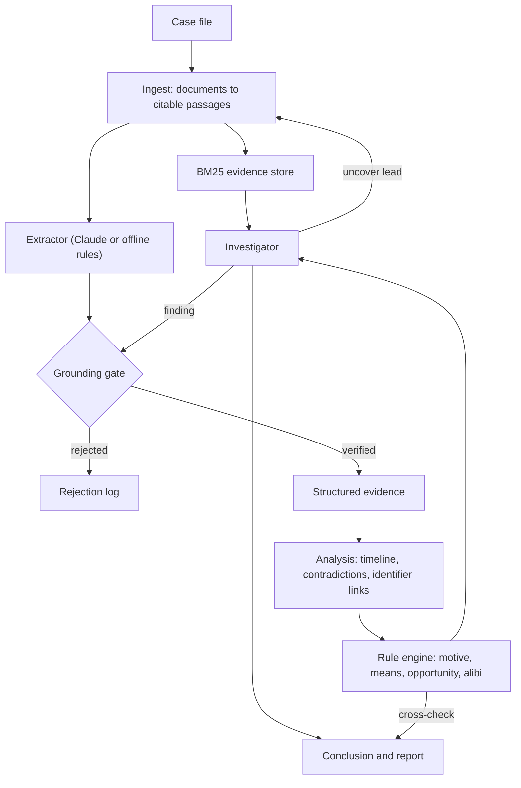

# AI Detective

A web application for investigating fictional mysteries from scattered evidence. It reads a case file of interviews, chats, emails, CCTV summaries and system logs, builds a timeline, finds contradictions, connects clues across documents, and names the most likely suspect in a report where every claim traces to a verbatim source quote.

It is built so that **the model reads and judges, and code checks**. Claude extracts structured evidence and runs the investigation. Deterministic code verifies every quote, computes the timeline and contradictions, and cross-checks the conclusion.

## Status of this build

| Part | State |
|---|---|
| Deterministic pipeline, guards, evaluator, CLI, web API | Tested. The full suite passes with no credentials. |
| Web interface | Driven in a real browser: investigating, opening leads, search, citation jumps, questions, report, answer key, creating and deleting a case, phone width, light and dark. The zip picker's server side is tested; the file dialog itself was not clicked. |
| Claude integration through the real SDK | Tested with no key against a **local fake of the API**: all three cases run end to end through the real SDK, extractor and agent loop, alongside a model that fabricates evidence, obeys injected instructions or never finishes, and an API that fails. |
| Groq integration through the real SDK | Tested with no key against a local fake of its API, in the same way. |
| **Claude or Groq solving the cases for real** | **Not yet run.** No API key was available during development, so neither provider has a measured result. `pytest -m live` produces one. Prompts were written for Claude, so Groq's model may need its own tuning. |

The offline backend scores 100% on all three cases, but treat that as a regression baseline and nothing more. Its rules were written alongside these cases, so the score does not show that it would handle a new one. See [Limitations](#limitations).

## Quick start

```bash
python -m venv .venv
```

Activate it, then install:

```bash
pip install -e ".[dev]"
```

Start the application and open <http://127.0.0.1:8000>. No key is needed for the offline investigator:

```bash
python -m detective serve
```

To use a model, set a key in the same shell before starting the server. Keys stay in the server's environment and are never entered in the page or stored in the project.

| Investigator | Key | Model |
|---|---|---|
| Claude | `ANTHROPIC_API_KEY`, or `ant auth login` | `claude-opus-5-5` |
| Groq | `GROQ_API_KEY` | `openai/gpt-oss-120b`, or set `GROQ_MODEL` |
| Offline rules | None | Fixed rules, for the sample cases |

In PowerShell:

```powershell
$env:GROQ_API_KEY = "your-key"
```

The app preselects the first investigator with a key. Groq is a choice you make, not an automatic failover: if a run fails, it stops and tells you why, so a verdict never comes from a model you did not pick. `GROQ_MODEL` must support both tool use and strict structured outputs, which rules out the Llama models.

## Using the application

1. **Pick a case**, or create one with **New case**, or use **Import zip** for a full case with sealed leads.
2. **Investigate.** Choose Claude, Groq or the offline rules. Turn off *Follow sealed leads automatically* to stay within the open file. Progress appears live.
3. **Review.** Summary gives the verdict, confidence, how the assessment changed, and facts, assumptions and speculation. Every citation chip jumps to the exact line in its source.
4. **Explore.** Search the evidence, read the timeline, compare suspects, review contradictions and read the reasoning log.
5. **Open leads** one at a time and watch the assessment change.
6. **Ask** follow-up questions. Answers come only from opened evidence, and the app says so when the file has no answer.
7. **Download the report**, and check the result on the **Answer key** tab for cases that have one.

Results, questions and custom cases are saved in `data/` (or wherever `DETECTIVE_DATA` points) and survive a restart without repeating any model calls. Interactive API docs are at `/api/docs`.

### Command line

Everything also works without the web interface:

```bash
python -m detective list
python -m detective solve case_03_halden_codex --no-leads
python -m detective uncover case_03_halden_codex L1
python -m detective ask case_03_halden_codex "Who is on the Brandt landline call to Greta Brandt?"
python -m detective evaluate
```

Add `--backend claude` or `--backend groq` to use a model. Each solve writes `runs/<case>/report.md` and a reasoning trace to `trace.json`. Sample reports are in [examples/](examples/).

### Tests

No key is needed. The live tests skip themselves:

```bash
pytest
```

| Tests | What they prove with no key |
|---|---|
| `test_known_outcomes.py`, `test_metamorphic.py`, `test_analysis.py`, `test_grounding.py`, `test_followups.py` | The offline pipeline, guards and answer keys |
| `test_claude_backend.py`, `test_no_key.py` | The Claude path through the real SDK against `fake_claude.py`: every case end to end, sealed evidence withheld, a misbehaving model, API failures, and clear messages when no key is set |
| `test_groq.py` | The same for the Groq path through the real Groq SDK: every case end to end, the translation to Groq's format, the shared guards, and failures |
| `test_app.py` | The whole application through its HTTP API |
| `test_heldout.py` | A case written after the offline rules were frozen, the one unbiased check on them |

The fake APIs exercise plumbing and guards. Their scripted model simply files the rule engine's leader, so a pass says nothing about a real model's judgement. With a key, this measures that for each provider you have a key for, at real token cost:

```bash
pytest -m live
```

## The three cases

| Case | Difficulty | Twist |
|---|---|---|
| The Missing Prototype Laptop | Easy | Four suspects. A complete door log leaves one person with time on site, and that person lied about leaving. A sealed shop receipt joins the serial number to their phone. |
| The Aldermere Necklace | Twisted | Every suspect has an alibi, so at least one record must be wrong. The manager's perfect CCTV alibi falls once a ticket reveals that the camera clock runs 25 minutes fast. A bellhop lies, and a planner lies for an unrelated reason. |
| The Halden Codex | Impossible | Six suspects, and a badge log, motive and planted supplies all frame the head archivist. Carrier records put him at home during the badge use, which shows the badge was misused. A phone number hidden in a company registry exposes the deputy director, and a bank trail exposes her accomplice. One anonymous note contains a prompt injection. |

Each case has a `solution.json`. Only `detective/evaluation.py` reads it, and a test enforces that.

## How it works



| Module | Responsibility |
|---|---|
| `models.py` | Pydantic schema for evidence, citations, findings and conclusions |
| `ingest.py` | Loads cases and splits documents into passages with stable IDs such as `D2:p11` |
| `store.py` | BM25 search with stemming and alias expansion |
| `grounding.py` | The anti-hallucination gate |
| `claude_backend.py` | Structured extraction, agent loop and Q&A with Claude |
| `groq_backend.py` | The same behind Groq, by translating requests at the gateway so all guards are shared |
| `tools.py` | Tools the agent uses, each one guarded |
| `heuristic.py`, `rules.py` | Offline extractor and reasoner |
| `analysis.py` | Timeline, clock correction, contradictions, identifier graph |
| `engine.py` | Suspect scoring and confidence rules |
| `investigation.py` | Evidence state, reassessment rounds, reasoning log |
| `report.py`, `evaluation.py`, `cli.py` | Output, scoring and command line |
| `workspace.py` | Application service: one workspace per case, background runs, saved sessions |
| `authoring.py` | Case creation and zip import, with validation |
| `server.py`, `web/` | REST API and single-page interface, with no external scripts or build step |

### Key decisions

**Lexical retrieval rather than embeddings.** Case files are small, and names, times and identifiers matter more than paraphrase. BM25 is deterministic and explainable, and there is no embedding service to depend on. Stemming, aliases and a few log-vocabulary synonyms close the common gaps. The agent also compensates by searching repeatedly and reading full documents.

**Defeaters are first-class evidence.** A clock offset or a misused credential is a statement *about* other evidence. Each round re-derives everything from scratch, so new evidence can withdraw an earlier inference. For example, opening the fob register before the clock ticket makes the fob look misused, and opening the ticket then reverses that. A test covers this.

**Impossible co-location is a rule.** When two records put one person in two places and one of them is only a credential, the direct record stands and the credential use is no longer attributed to its holder. This is how the Halden Codex frame-up falls apart.

**The engine cross-checks Claude and does not overrule it.** Extraction can miss things Claude catches by reading, so disagreement is allowed. Claude must explain it, and the report shows it prominently.

## Requirements coverage

| Requirement | Where |
|---|---|
| Multiple evidence types | `DOC_TIERS` in `models.py`: tips, testimony, chats, emails, logs, CCTV, financial and phone records |
| Entities, events, timestamps | `DocExtraction` schema, using Claude structured outputs |
| Timeline | `analysis._build_timeline`, keeping both stated and corrected times |
| Contradiction detection | `analysis._detect`, plus `record_contradiction` for clashes in meaning |
| Connecting clues | Identifier graph in `analysis._find_links`, plus the agent's reading |
| Suspects, motives, opportunities, alibis | `engine.py` |
| Follow-up questions | `ask`, with cited answers and an explicit "no evidence" outcome |
| Citations | `Citation` on every extracted item and finding |
| Facts, assumptions, speculation | `Status`, enforced by `Grounding.check_finding` |
| Confidence with explanations | `Engine._confidence` and the agent's `confidence_explanation` |
| Final report | `report.py` |
| Uncovering evidence | Sealed leads, `uncover` and per-round history in the report |
| Reasoning steps | `ReasoningStep` log, saved as `trace.json` |
| Automated tests against outcomes | `tests/test_known_outcomes.py` and `evaluation.py` |

## How invented evidence is prevented

The gate in `grounding.py` is mechanical, so a persuasive model cannot talk its way past it.

- A citation must point to an opened passage and quote it verbatim. Sealed evidence cannot be cited until it is uncovered.
- A person named by an event must appear in the cited passage or be its speaker. A time must appear in the passage. Unknown people and places are refused.
- A "fact" must rest on a document-tier source or on two independent sources. Otherwise it is downgraded to an assumption and the report says so.
- A conclusion must cite at least one fact, cannot rest on speculation, must name a real suspect, and must account for every other suspect.
- Rejected extractions go in a log, and the report counts them. A rejected finding goes back to the agent as an error so it can correct itself.

Documents are treated as data. The prompts say so, passages are delimited, and the Codex case contains an embedded injection attempt. Anonymous sources carry no weight in the engine. Offline tests confirm that the note has no effect, but **whether Claude ignores it can only be confirmed by a live run**.

## Evaluation

```bash
python -m detective evaluate --backend claude --output results.json
```

Metrics per case: culprit, confidence against the required level, accomplices, contradiction recall, timeline recall, key evidence cited, retrieval recall@5, citation validity and red herrings avoided. It also checks who led in round 0 and who a naive evidence count would blame, because the point of the harder cases is to move away from that person.

Current offline baseline:

| Metric | Laptop | Necklace | Codex |
|---|---|---|---|
| Culprit | Sam Whitlock | Victor Hale | Helena Marsh |
| Confidence | HIGH | HIGH | HIGH |
| Contradiction recall | 100% | 100% | 100% |
| Timeline recall | 100% | 100% | 100% |
| Key evidence cited | 100% | 100% | 100% |
| Retrieval recall@5 | 100% | 100% | 100% |
| Citation validity | 100% | 100% | 100% |

`tests/test_metamorphic.py` guards against a solver tuned to specific names: swapping the culprit and a decoy across all documents must swap the verdict, removing a piece of evidence must change the inference that used it, and removing the clock ticket must leave the alibi standing.

## Security

The server is meant for one person on their own machine, and it has no login. It binds to `127.0.0.1` by default; do not expose it to a network.

- A malicious site open in the same browser cannot start paid Claude runs: writes need a custom header, which triggers a CORS preflight the server never approves, and a host allowlist stops DNS rebinding.
- Zip imports are limited in size and file type, refuse path traversal, and are validated in a temporary folder before being installed.
- Case documents are untrusted, so the interface renders them only as text. A test checks that it never writes raw HTML.
- Sealed documents and the answer key are not served until the investigator opens or requests them.

## Limitations

- **Groq's request format is checked against its documentation only.** Strict schemas and the tool-call retry have not met the real service, and `tool_use_failed` is not described on Groq's error pages. The first live run may need small changes in `groq_backend.py`.
- **No live results yet.** Prompts have not been tuned against real Claude output, so expect some iteration on the first live run. Extraction quality, resistance to the injection and the accuracy of the agent's reasoning are all unmeasured.
- **The offline rules are overfitted by construction.** They are for reproducible tests, not for new cases. The held-out case shows this: on plain wording they read one timeline entry and name the wrong suspect, at LOW confidence and without inventing anything. That test is marked as an expected failure, and the rules should not be tuned to pass it. The metamorphic tests show the logic is not keyed to names, not that the patterns generalise.
- **The cases, answer keys and code share one author.** A blind evaluation on cases written by someone else would be a stronger test.
- **Engine weights are hand-set.** They rank suspects and do not represent probabilities, and with only three cases they are not validated.
- **Crime windows and the cast come from the case sheet.** A case where the window itself is in dispute would need the window to become a finding.
- **`max_tokens` is 16,000 per request**, without streaming. A very long agent turn stops with a clear error rather than being resumed.
- **A run in progress does not survive a server restart.** The last finished result does; an interrupted run must be started again. There is no cost cap on a Claude run beyond its 40-turn limit.
- **One user at a time.** There are no accounts, and saved results are not shared between machines.
- **Requests use the server-side refusal fallback** (`fallbacks: "default"`). Crime fiction can trip safety classifiers, and this keeps a false positive from ending a run. Drop it from `ClaudeGateway` if you do not want a declined request re-run on another model.

## Adding a case

The **New case** form covers most needs. For sealed leads or an answer key, zip a folder holding `case.json` for the cast, locations, crime window and leads, `documents/*.txt` for the file, `sealed/*.txt` for leads, and optionally `solution.json`, then use **Import zip**. The case folders in `cases/` are working examples. Each document starts with front matter:

```text
---
id: D1
type: witness_interview
title: Interview with Sam
date: 2025-03-14
event_date: 2025-03-13
speaker: Sam Whitlock
---
```

Use `device:` for log sources so clock corrections can find them.
